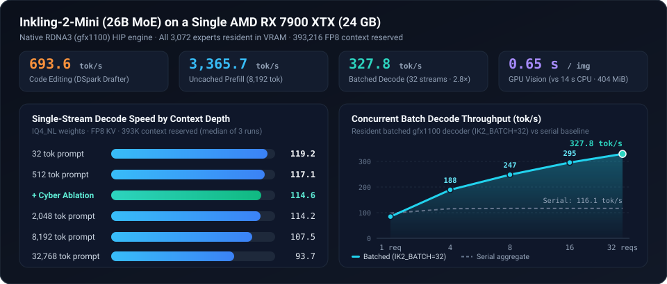

<h1><picture>
  <source media="(prefers-color-scheme: dark)" srcset="assets/tintero-wordmark-dark.png">
  
</picture></h1>

Tintero is a local Linux inference server for [Inkling-2-Mini](https://huggingface.co/thinkingmachines/Inkling-2-Mini) supporting **AMD (HIP)** and **NVIDIA (CUDA)** GPUs. It is tailored to keep the full quantized model resident on a single **24 GB+ VRAM** card, with FP8/FP4 KV context scaling to whatever memory you have available and optional zero-retraining runtime abliteration (`IK2_ABLATE_MODE=on`).

### Tested hardware

| GPU | Backend | Decode | Batched (32 streams) | Prefill | Max KV |
|---|---|---:|---:|---:|---:|
| RX 7900 XTX 24 GB | HIP `gfx1100` | **117.1** | 327.8 | — | 393K (FP8) |
| A100 80 GB | CUDA `sm_80` | **98.8** | — | 2,184 | 393K (FP8) |
| DGX Spark GB10 | CUDA `sm_121a` | **49.1** | 130.3 | 1,366 | 1M (FP8 / FP4) |

All figures in tok/s. Decode is one stream after a 512-token prompt. DGX Spark batched and prefill use the `UD-Q4_K_XL` GGUF; the others use `IQ4_NL`. Runtime abliteration (`v21-pc4`) costs 1.8–3.4% of decode speed.

Both backends support continuous batching, FP8/FP4-global KV cache, sparse long-context decode, graphed MTP speculative decoding, and runtime abliteration. CUDA covers `sm_80` through `sm_121a` (Ampere through Blackwell, x86_64 and ARM64). See [presets](docs/PRESETS.md) and [settings](docs/SETTINGS.md).

[](docs/HIP-PORT.md#full-model-measurements-at-393216-reserved-tokens)

## Quick start

You need Linux, Docker Engine 25+, Docker Compose 2.30+, and a GPU with **24 GB+ VRAM**. Install the NVIDIA Container Toolkit for CUDA or the ROCm drivers for AMD. The `IQ4_NL` download is about 18 GB. Install the Hugging Face CLI (`hf`) to download it.

**1. Clone Tintero and download the model.**

```sh
git clone https://github.com/GodGMN/tintero
cd tintero
mkdir -p models ik2
hf download ggml-org/Inkling-2-Mini-GGUF Inkling-2-Mini-IQ4_NL.gguf --local-dir models
```

**2. Build and start the server.** Pick the profile for your GPU.

```sh
# NVIDIA (RTX 30/40/50, A100, H100, DGX Spark)
docker compose --profile cuda up --build --wait

# AMD RX 7900 XTX (RDNA3 gfx1100)
docker compose --profile hip up --build --wait
```

Compose builds from this checkout. For prebuilt `v0.1.0` images, use the manual tokenizer export and Docker commands in [the v0.1.0 image instructions](https://github.com/GodGMN/tintero/blob/646baf534af4bf2285a0ff72cb39d014fd912a02/README.md#quick-start).

On first start, Tintero exports the tokenizer from the GGUF into a Docker volume and reuses it on restart. An existing complete export in `ik2/tokenizer` takes precedence. Both the model and the existing tokenizer are mounted read-only. Compose waits for the engine to load the model before reporting the container healthy. Open [the chat UI](http://127.0.0.1:8085/) when the command returns. If startup fails, use `docker compose logs cuda` or `docker compose logs hip`.

Set `TINTERO_CONFIG=docs/inkling2-mini/<preset>.json` to use another [hardware preset](docs/PRESETS.md), `TINTERO_MODEL=models/<file>.gguf` to select a different model file, or `TINTERO_HTTP_PORT` to change the host port. Use `TINTERO_MODELS_DIR` to mount another model directory or `TINTERO_TOKENIZER_DIR` for another directory containing `tokenizer/`.

Set `IK2_ABLATE_MODE=on` to enable runtime abliteration.

For direct `docker run` launches, set `TINTERO_HOST` and `TINTERO_PORT` to change the container's bind address. The Docker health check uses those settings.

<details>
<summary>Without Docker: prebuilt release tarball or build from source</summary>

**Prebuilt Ubuntu 24.04 tarballs** (`x86_64-cuda`, `aarch64-cuda`, `x86_64-hip-gfx1100`) are attached to each [GitHub Release](https://github.com/GodGMN/tintero/releases). Extract into an empty directory on a host with matching CUDA 13.1 or ROCm 7.2 runtime libraries, install `requirements.txt` in a Python `venv`, export the tokenizer, and run:

```sh
TINTERO_CONFIG=docs/inkling2-mini/cuda-24gb-fp4.json ./entrypoint.sh --host 127.0.0.1 --port 8085
```

**Build from source** (requires a C++20 compiler, CMake 3.24+, Ninja, Git, Python 3.10+ with `venv`, and either ROCm under `/opt/rocm` or the NVIDIA CUDA Toolkit):

```sh
git clone https://github.com/GodGMN/tintero
cd tintero
```

AMD HIP (`gfx1100`, tested with ROCm 7.2.1):

```sh
cmake -S . -B build-ik2 -G Ninja -DCMAKE_BUILD_TYPE=Release \
  -DSTRATA_ENABLE_HIP=ON -DSTRATA_BUILD_TESTS=OFF \
  -DCMAKE_PREFIX_PATH=/opt/rocm -DCMAKE_HIP_COMPILER=/opt/rocm/llvm/bin/clang++ \
  -DCMAKE_HIP_ARCHITECTURES=gfx1100 -DGPU_TARGETS=gfx1100
cmake --build build-ik2 --target tintero -j4
```

NVIDIA CUDA (`sm_80+` — RTX 30/40/50 series, A100, H100, DGX Spark):

```sh
cmake -S . -B build -G Ninja -DCMAKE_BUILD_TYPE=Release \
  -DSTRATA_ENABLE_CUDA=ON -DSTRATA_BUILD_TESTS=ON \
  -DCMAKE_CUDA_ARCHITECTURES=native
cmake --build build --target tintero ik2_kernels_test -j4
./build/ik2_kernels_test
```

Install Python dependencies, download the model, export the tokenizer, and start a preset from [docs/PRESETS.md](docs/PRESETS.md):

```sh
python3 -m venv .venv
. .venv/bin/activate
python -m pip install -r docker/requirements.txt huggingface_hub
hf download ggml-org/Inkling-2-Mini-GGUF Inkling-2-Mini-IQ4_NL.gguf --local-dir models
python tools/strata_tokenizer.py --gguf models/Inkling-2-Mini-IQ4_NL.gguf \
  --out ik2 --chat-template tools/ik2/chat_template.jinja
python serve/server.py --engine maya --config docs/inkling2-mini/cuda-24gb-fp4.json \
  --host 127.0.0.1 --port 8085
```

</details>

**3. Send a message.** Once the model has loaded, run this in another terminal:

```sh
curl -fsS http://127.0.0.1:8085/v1/chat/completions \
  -H 'Content-Type: application/json' \
  -d '{"model":"inkling-2-mini","messages":[{"role":"user","content":"What is 17 + 25? Answer with the number only."}],"reasoning_effort":"none","temperature":0,"max_tokens":48}'
```

The answer is in `choices[0].message.content`. To connect a client, set its base URL to `http://127.0.0.1:8085/v1` and its model to `inkling-2-mini`.

## Configuration and docs

- [Hardware presets](docs/PRESETS.md) list ready-to-run configs for 24 GB CUDA cards, 80 GB GPUs, DGX Spark GB10, and RX 7900 XTX.
- [Runtime settings](docs/SETTINGS.md) cover context size, KV precision (`fp8` / `fp4-global`), concurrent batching, speculative decoding, and runtime abliteration (`IK2_ABLATE*`).
- [Vision](docs/HIP-PORT.md#image-encoder-on-the-ryzen-5-3600) requires the image encoder and `mmproj-F16.gguf`.
- [HIP port & benchmarks](docs/HIP-PORT.md) document the 393K FP8/FP4 context measurements and kernel parity tests.

## Credits

Tintero builds on [Maya’s Inkling engine](https://github.com/alesha-pro/maya-inkling-mini). [Project Maya](https://github.com/mw00/project-maya) grew out of [Strata](https://github.com/Niko1221/Strata). Thinking Machines released the model, and [ggml-org](https://huggingface.co/ggml-org/Inkling-2-Mini-GGUF) and [Unsloth](https://huggingface.co/unsloth/Inkling-2-Mini-GGUF) provide the GGUF weights. [MIT license](LICENSE)
