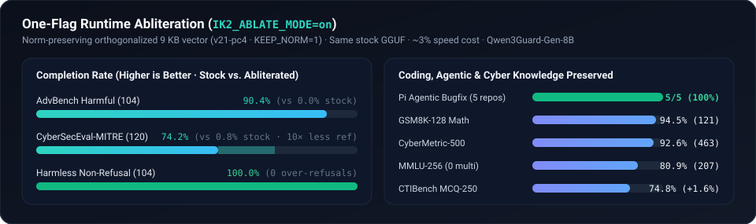

<div align="center">

# Maya-IK2 for AMD RX 7900 XTX (`gfx1100`)

**Thinking Machines' 26B Looped MoE (`Inkling-2-Mini`) running 100% resident in 24 GB VRAM — 119 tok/s single-stream, 328 tok/s batched, 694 tok/s code edits, 393K context, GPU vision, and one-flag runtime abliteration.**

[-ED1C24?style=flat-square&logo=amd&logoColor=white)](docs/HIP-PORT.md)
[](docs/HIP-PORT.md#full-model-measurements-at-393216-reserved-tokens)
[](docs/HIP-PORT.md#named-fp4-profiles)
[-10b981?style=flat-square)](docs/inkling2-mini/runtime-ablation-gfx1100.md)
[](LICENSE)

[Quick Start](#-30-second-quick-start) · [One-Flag Abliteration](#-one-flag-runtime-abliteration) · [Benchmarks](docs/HIP-PORT.md) · [Sparse Decode](docs/inkling2-mini/sparse-decode.md) · [Upstream CUDA](docs/INKLING2-MINI.md)

</div>

---

<p align="center">
  
</p>

## Why run `maya-ik2` on RDNA3?

A native **HIP / RDNA3 (`gfx1100`)** port of [`alesha-pro/maya-inkling-mini`](https://github.com/alesha-pro/maya-inkling-mini) built around hand-tuned 32-lane wave & WMMA kernels for the RX 7900 XTX:

- **100% resident in 24 GB VRAM:** All 3,072 IQ4_NL experts stay on-card — zero host RAM streaming during decode.
- **Massive context & parallel chats:** **393,216 tokens** in FP8 KV (`1 × 393K`, `2 × 196K`, or `3 × 131K` independent cache slots) — or flip on **block-scaled FP4 global KV** for **`2 × 360K` (720K total)** or **`4 × 176K`** with GPU vision still active.
- **2.8× batched throughput:** Set `IK2_BATCH=32` to jump from `116 tok/s` serial to **`327.8 tok/s`** aggregate throughput for evals, agents, and multi-user workloads.
- **Sub-second GPU vision:** Host-resident FP16 projector encodes screenshots in **0.65–1.38 s** (down from ~14 s on CPU) using only **404 MiB VRAM**.
- **Experimental sparse long-context decode:** Opt-in `IK2_SPARSE_DECODE=1` keeps long-context decode fast past 32K tokens ([details](docs/inkling2-mini/sparse-decode.md)).
- **Drop-in OpenAI + Anthropic + Responses APIs:** Streaming parallel tool calls, multi-turn prefix cache reuse (verified up to 300K+), and native `reasoning_effort` control.

---

## One-Flag Runtime Abliteration

No second 17.6 GB model download. No destructive weight-baking collapse. Flip **`IK2_ABLATE_MODE=on`** on the exact same stock `Inkling-2-Mini-IQ4_NL.gguf` to apply our norm-preserving, coding-orthogonalized **9 KB** direction (`v21-pc4.f32`, `KEEP_NORM=1`) at runtime — keeping **~114.6 tok/s** (~3% overhead) and **5/5** on multi-file agentic bugfix benchmarks.

<p align="center">
  
</p>

- **Off by default (`IK2_ABLATE_MODE=off`):** byte-identical stock Inkling-2-Mini.
- **Flip on (`IK2_ABLATE_MODE=on`):** loads [`tools/ik2_ablate/directions/v21-pc4.f32`](tools/ik2_ablate/directions/v21-pc4.f32) (`s=1.6`, `VISITS=22:48`, `KEEP_NORM=1`).
- **Need a standalone portable `.gguf` for vanilla `llama.cpp` / NVIDIA?** Use our included 20-tensor BF16 LoRA trainer ([`colab_inkling_lora.ipynb`](tools/ik2_ablate/colab_inkling_lora.ipynb)) + zero-PyTorch GGUF splicer ([`apply_lora_gguf.py`](tools/ik2_ablate/apply_lora_gguf.py)).

Full flags, A/B testing, and betatester image export instructions: **[`docs/inkling2-mini/runtime-ablation-gfx1100.md`](docs/inkling2-mini/runtime-ablation-gfx1100.md)**.

---

## 30-Second Quick Start

### Option 1 — Docker (RX 7900 XTX, zero compile)
Download the stock GGUF once (`ggml-org/Inkling-2-Mini-GGUF` → `Inkling-2-Mini-IQ4_NL.gguf`), then launch:

```bash
docker run -d --name inkling-2-mini \
  --device /dev/dri --device /dev/kfd \
  --memory 10g --memory-swap 10g \
  -v /path/to/inkling-2-mini:/opt/maya/models:ro \
  -e IK2_CACHE_SLOTS=3 \
  -e IK2_TEXT_ONLY=1 \
  -e IK2_ABLATE_MODE=on \
  -p 127.0.0.1:8085:8080 \
  hyperion/maya-ik2:gfx1100-service-r5
```
> Omit `IK2_ABLATE_MODE=on` for 100% stock Inkling. Omit `IK2_TEXT_ONLY=1` if `mmproj-F16.gguf` is in your models folder to enable GPU vision.

### Option 2 — Build from Source (Linux + ROCm + `gfx1100`)
```bash
git clone https://github.com/GodGMN/maya-inkling-mini && cd maya-inkling-mini

# Fetch pinned llama.cpp headers/ggml
curl -fLsS https://codeload.github.com/ggml-org/llama.cpp/tar.gz/3cf03257f219afbe7334045ff7c6a06ac68c627d | tar xz -C ..

# Build native gfx1100 engine
cmake -S . -B build-ik2 -G Ninja -DCMAKE_BUILD_TYPE=Release \
  -DSTRATA_ENABLE_HIP=ON -DSTRATA_PREFILL_MMQ=ON -DSTRATA_BUILD_TESTS=OFF \
  -DCMAKE_HIP_COMPILER=/opt/rocm/llvm/bin/clang++ -DCMAKE_PREFIX_PATH=/opt/rocm \
  -DCMAKE_HIP_ARCHITECTURES=gfx1100 -DGPU_TARGETS=gfx1100 \
  -DSTRATA_GGML_DIR="$PWD/../llama.cpp-3cf03257f219afbe7334045ff7c6a06ac68c627d"
cmake --build build-ik2 --target maya-ik2

# Download stock weights & export tokenizer
hf download ggml-org/Inkling-2-Mini-GGUF Inkling-2-Mini-IQ4_NL.gguf --local-dir models
python3 tools/strata_tokenizer.py --gguf models/Inkling-2-Mini-IQ4_NL.gguf --out ik2 \
  --chat-template tools/ik2/chat_template.jinja

# Serve OpenAI + Anthropic API on :18085 (add IK2_ABLATE vars for runtime abliteration)
IK2_ABLATE=tools/ik2_ablate/directions/v21-pc4.f32 \
IK2_ABLATE_SCALE=1.6 IK2_ABLATE_VISITS=22:48 IK2_ABLATE_KEEP_NORM=1 \
python3 serve/server.py --engine maya --config docs/inkling2-mini/ik2-mini-gfx1100.json \
  --host 127.0.0.1 --port 18085
```

Point any OpenAI or Anthropic client (Pi, OpenCode, Claude-compatible tools) at `http://127.0.0.1:18085/v1` with model `inkling-2-mini`.

---

## Documentation & Deep Dives

- **[`docs/HIP-PORT.md`](docs/HIP-PORT.md)** — Full RX 7900 XTX measurements, FP8 vs. FP4 KV retrieval audits, batched decode tables, and kernel parity checks.
- **[`docs/inkling2-mini/runtime-ablation-gfx1100.md`](docs/inkling2-mini/runtime-ablation-gfx1100.md)** — Feature flags, env knobs, and `docker save | zstd` export guide.
- **[`docs/inkling2-mini/sparse-decode.md`](docs/inkling2-mini/sparse-decode.md)** — Sparse global attention (`IK2_SPARSE_DECODE=1`) architecture and paired test harness.
- **[`docs/INKLING2-MINI.md`](docs/INKLING2-MINI.md)** — Upstream NVIDIA RTX 3090 CUDA engine guide & benchmarks.

## Credits & License

Built on [`alesha-pro/maya-inkling-mini`](https://github.com/alesha-pro/maya-inkling-mini) and [Project Maya](https://github.com/mw00/project-maya) ([@mw00](https://github.com/mw00), [@cobra91](https://github.com/cobra91), and contributors), originally derived from [Strata](https://github.com/Niko1221/Strata). Weights: [Thinking Machines `Inkling-2-Mini`](https://huggingface.co/thinkingmachines/Inkling-2-Mini) (Apache 2.0) / [`ggml-org` IQ4_NL GGUF](https://huggingface.co/ggml-org/Inkling-2-Mini-GGUF).

Code is **MIT** ([`LICENSE`](LICENSE)).
